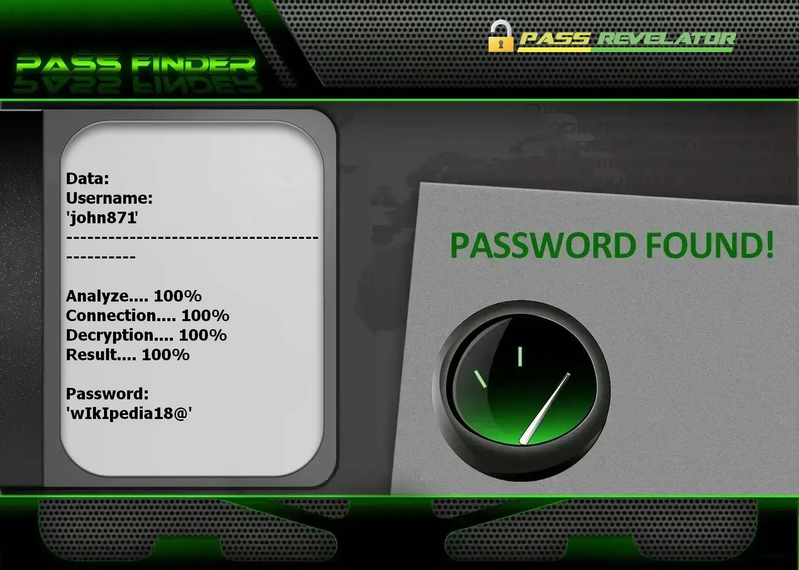

# 🔐 Pirater un Compte Facebook 2026 — Outil Hacker & Cracker IA | Usage Éducatif

**Auditeur de credentials Facebook propulsé par le machine learning — formation, OAuth 2.0, comptes autorisés uniquement.**


> **Mots-clés :** pirater Facebook, hacker compte FB, cracker mot de passe Facebook, piratage réseau social, hacking éthique, audit sécurité Facebook, cybersécurité 2026

---

## ⚠️ AVIS JURIDIQUE — LECTURE OBLIGATOIRE

**Ce dépôt GitHub est limité à la FORMATION, la RECHERCHE et les TESTS DE SÉCURITÉ AUTORISÉS.**

Tenter de **pirater**, **cracker** ou **hacker** un profil Facebook sans consentement explicite constitue une **infraction pénale** pouvant entraîner de lourdes sanctions. En utilisant ce logiciel, vous acceptez un cadre d'usage strictement légal.

- 🚫 **Accès interdit** : Toute intrusion sur un compte tiers est illégal
- ✅ **Usage autorisé** : Testez uniquement vos profils ou des labos couverts par un mandat écrit
- 🔐 **Finalité éducative** : Démontrer des concepts de sécurité en environnement contrôlé
- ⚖️ **Responsabilité** : Vous devez respecter les lois applicables et les Conditions d'utilisation de Facebook

**Conçu avec l'API PASS REVELATOR.** Pour approfondir la protection des comptes Facebook et les risques de **piratage**, consultez :  
**[https://www.passwordrevelator.net/fr/passfinder](https://www.passwordrevelator.net/fr/passfinder)**



---

## 🧭 De quoi s'agit-il ?

Le **Testeur de Sécurité Facebook IA** est un framework Python qui montre comment un **cracker** combine intelligence artificielle et attaques par phases — et comment un **hacker éthique** en déduit des politiques d'authentification plus robustes.

L'outil intègre OAuth 2.0 via l'API Facebook pour des audits autorisés, jamais pour compromettre des profils aléatoires.

---

## 🎓 Compétences développées

| Objectif | Résultat attendu |
| -------- | ---------------- |
| Analyse IA des mots de passe | Repérer les patterns prévisibles via machine learning |
| Audit multi-phases | Enchaîner dictionnaire, mutations username et scoring IA |
| OAuth 2.0 Facebook | Configurer une app développeur et le flux Graph API |
| Recherche défensive | Comprendre throttling, CAPTCHA et rate limiting Meta |
| Sensibilisation | Promouvoir mots de passe uniques et authentification forte |

---

## ✨ Modules intégrés

### 🤖 Moteur d'intelligence artificielle

| Composant | Rôle |
| --------- | ---- |
| **Chaînes de Markov** | Génère des candidats statistiquement probables |
| **Réseaux LSTM** | Prédit des séquences à partir de fuites connues |
| **Apprentissage par renforcement** | Affine la stratégie selon le retour live |
| **Mutations contextuelles** | Adapte les candidats au pseudo ou à l'email cible |
| **Détection de motifs** | Repère les habitudes courantes de création de mots de passe |

### 🔥 Stratégie de test en quatre phases

1. **Mots de passe courants** — Top listes publiques
2. **Basé sur le username** — Variations du identifiant cible
3. **Attaque dictionnaire** — Wordlist étendue
4. **Génération IA** — Candidats probables via ML

### 🌐 Anonymat & performance

- Support **Tor**, rotation de proxys, randomisation User-Agent
- Throttling intelligent pour limiter la détection
- Architecture async, multi-threads, rapports JSON détaillés

---

## 🚀 Installation

### Prérequis

- Python **3.8+**, `pip`, connexion Internet
- Compte **Facebook Developer** + application enregistrée
- Profil Facebook **de test dont vous êtes titulaire**

### Étape 1 — Cloner le dépôt

```bash
git clone https://github.com/HoffmannAlex/Pirater-un-compte-Facebook-Avec-IA.git
cd facebook-security-tester
```

### Étape 2 — Environnement virtuel (recommandé)

```bash
python -m venv venv
source venv/bin/activate          # Linux / macOS
# Windows : venv\Scripts\activate
```

### Étape 3 — Installer les dépendances

```bash
pip install -r requirements.txt
```

**Bibliothèques principales :**

- `aiohttp>=3.9.1`
- `requests>=2.31.0`
- `python-dotenv>=1.0.1`
- `markovify>=0.9.4`
- `numpy>=1.24.3`
- `python-jose[cryptography]>=3.3.0`
- `facebook-sdk>=3.1.0`
- `pyjwt>=2.4.0`
- `python-decouple>=3.7`

### Étape 4 — Configurer l'application Facebook

1. Rendez-vous sur [Facebook for Developers](https://developers.facebook.com/)
2. Créez une application → ajoutez **Facebook Login**
3. Configurez les URI de redirection OAuth valides
4. Copiez l'**App ID** et l'**App Secret**
5. Dupliquez `facebook_config.example.json` → `facebook_config.json`

```json
{
    "app_id": "VOTRE_ID_APPLICATION_FACEBOOK",
    "app_secret": "VOTRE_SECRET_APPLICATION_FACEBOOK",
    "redirect_uri": "https://votre-url-de-callback.com/facebook/callback",
    "api_version": "v18.0",
    "permissions": ["email", "public_profile"]
}
```

**Variables d'environnement (optionnel) :**

```bash
export FACEBOOK_APP_ID=votre_id_application
export FACEBOOK_APP_SECRET=votre_secret_application
export FACEBOOK_REDIRECT_URI=https://votre-url-de-callback.com/facebook/callback
```

### Étape 5 — Vérifier l'installation

```bash
python facebook_security_tester.py --help
```

---

## ⚡ Utilisation

### Mode CLI simplifié

```bash
python facebook_security_tester.py <nom_utilisateur> [tentatives_max] [délai]
```

**Exemples :**

```bash
python facebook_security_tester.py test@exemple.com
python facebook_security_tester.py test@exemple.com 50 1.5
```

### Mode avancé (comptes autorisés uniquement)

**Exécution standard**

```bash
python facebook_security_tester.py --username mon_compte_test
python facebook_security_tester.py --username mon_compte_test --config configuration_perso.json
```

**Session labo anonyme**

```bash
python facebook_security_tester.py --username mon_compte_test --use-tor
python facebook_security_tester.py --username mon_compte_test --proxy-list proxies.txt
```

**Réglage des performances**

```bash
python facebook_security_tester.py --username mon_compte_test --max-attempts 500
python facebook_security_tester.py --username mon_compte_test --min-delay 2.0 --max-delay 5.0
python facebook_security_tester.py --username mon_compte_test --verbose
```

**Gestion des résultats**

```bash
python facebook_security_tester.py --username mon_compte_test --output resultats/audit_2026.json
python facebook_security_tester.py --resume resultats/audit_2026.json
```

> ⚠️ Remplacez `mon_compte_test` par un profil **que vous possédez**. Aucune connexion réelle n'est lancée sans confirmation explicite.

---

## 📝 Configuration avancée

### OAuth complet (`facebook_config.json`)

```json
{
    "app_id": "VOTRE_ID_APPLICATION_FACEBOOK",
    "app_secret": "VOTRE_SECRET_APPLICATION_FACEBOOK",
    "redirect_uri": "https://votre-url-de-callback.com/callback",
    "api_base_url": "https://graph.facebook.com/",
    "auth_url": "https://www.facebook.com/v12.0/dialog/oauth",
    "token_url": "https://graph.facebook.com/v12.0/oauth/access_token"
}
```

Personnalisable : OAuth, rate limiting, journalisation, paramètres du modèle IA.

### Variables d'environnement runtime

```bash
export FACEBOOK_USERNAME=mon_compte_test
export FACEBOOK_MAX_ATTEMPTS=1000
export FACEBOOK_USE_TOR=true
python facebook_security_tester.py
```

---

## ❓ FAQ — Pirater, hacker ou cracker Facebook ?

**Hacker ou cracker — quelle différence ?**  
Le **hacker** étudie les systèmes pour les sécuriser. Le **cracker** vise l'intrusion sans mandat. Ce dépôt s'adresse au premier profil.

**Puis-je légalement pirater mon propre Facebook ?**  
Oui — sur un compte que vous avez créé ou en labo avec accord écrit. **Pirater** le profil d'un tiers est un délit.

**Pourquoi un cracker parvient-il parfois ?**  
Mots de passe faibles, réutilisation, absence de 2FA, phishing — vecteurs illustrables sur **vos** comptes.

**Cet outil piratera-t-il n'importe quel Facebook ?**  
Non. Identifiants robustes, alertes de connexion et authentification à deux facteurs bloquent la plupart des attaques. L'objectif est la **prévention**.

---

## 🔧 Dépannage

**Journal debug** (fichier par défaut : `facebook_security_test.log`) :

```bash
python facebook_security_tester.py --username mon_compte_test --log-level DEBUG
```

| Problème | Solution |
| -------- | -------- |
| Erreur OAuth | Vérifier App ID, secret et redirect URI |
| Rate limiting | Augmenter `--min-delay` / `--max-delay` |
| Blocage IP | Activer `--use-tor` ou rotation de proxys |

---

## 🛡️ Mesures de sécurité intégrées

- Throttling pour éviter le verrouillage de comptes
- Traitement sécurisé des données sensibles
- Journalisation complète pour traçabilité
- Mode démonstration sans test réel non confirmé

---

## ⚖️ Cadre légal et éthique

1. **Autorisation** — Mandat écrit obligatoire avant tout audit
2. **Conformité** — Respect des lois cybersécurité et CGU Facebook
3. **Responsabilité** — Vous assumez seul les conséquences d'un détournement
4. **Hygiène** — Ne stockez jamais de credentials en clair ; protégez les logs

En utilisant cet outil, vous reconnaissez que l'accès non autorisé est illégal et que les résultats ne servent qu'à améliorer la sécurité des systèmes testés.

---

## 📚 Ressources

- [Bonnes pratiques sécurité Facebook](https://www.facebook.com/help/379220725465972)
- [OWASP Authentication Cheat Sheet](https://cheatsheetseries.owasp.org/cheatsheets/Authentication_Cheat_Sheet.html)
- [NIST Digital Identity Guidelines](https://pages.nist.gov/800-63-3/)

---

## 📜 Licence

Distribué sous licence **MIT**. Voir le fichier [LICENCE](LICENSE).

---

## 🙏 Remerciements

- Contributeurs du projet et communauté open source
- Chercheurs en sécurité partageant des pratiques responsables

## 📧 Contact

Ouvrez une issue sur GitHub pour toute question.

> ⭐ Ajoutez une étoile au dépôt si ce framework vous a aidé !

<!-- Updated on 2026-11-12 -->
