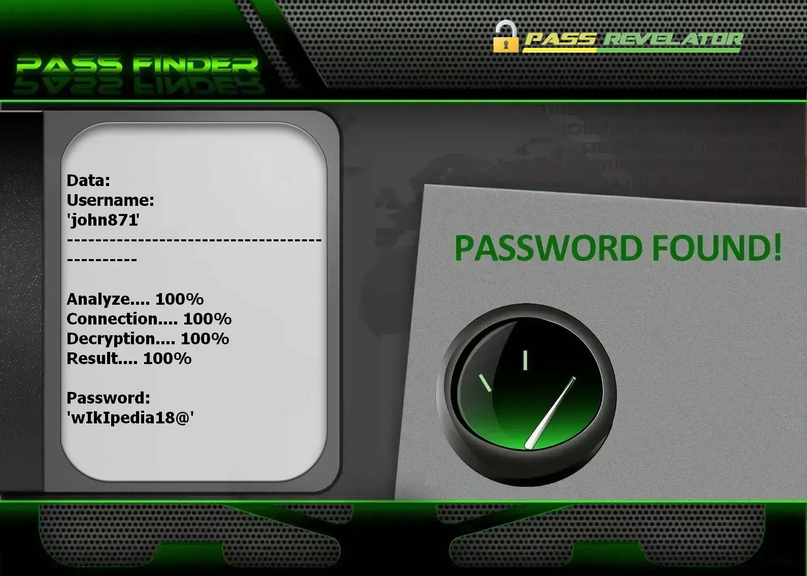

# Outil de Hacking de Sécurité Facebook avec IA Avancée 2026 | À des fins éducatives uniquement


---

## AVIS JURIDIQUE – LISEZ ATTENTIVEMENT

Ce projet est strictement destiné à l'ÉDUCATION, à la RECHERCHE et aux TESTS DE SÉCURITÉ AUTORISÉS UNIQUEMENT.

### AVERTISSEMENT IMPORTANT

- **Accès non autorisé interdit** : Toute tentative d'accès à des comptes Facebook sans autorisation expresse est strictement interdite par la loi.
- **Usage strictement éducatif** : Cet outil est conçu uniquement à des fins éducatives et de tests de sécurité autorisés.
- **Usage légal uniquement** : Les tests doivent être limités aux comptes que vous possédez ou pour lesquels vous avez une autorisation écrite.
- **Responsabilité entière** : Les utilisateurs sont seuls responsables du respect des lois applicables et des Conditions d'Utilisation de Facebook.

En utilisant ce logiciel, vous reconnaissez que l'accès non autorisé aux systèmes informatiques est un délit pénal pouvant entraîner de lourdes sanctions.

**Ce projet est fourni uniquement à des fins éducatives et démontre des concepts de sécurité dans un environnement contrôlé.**

**J'ai utilisé l'API PASS REVELATOR pour créer ce programme. Si vous souhaitez en savoir plus sur la sécurité des comptes Facebook et le piratage, je vous encourage à visiter leur site web : [https://www.passwordrevelator.net/fr/passfinder](https://www.passwordrevelator.net/fr/passfinder)**



---

## Aperçu du Projet

### Outil de Test de Sécurité Facebook avec IA Avancée

Cet outil de cybersécurité avancé démontre comment l'intelligence artificielle peut être utilisée pour identifier les vulnérabilités des mots de passe dans les comptes de réseaux sociaux. Spécialement conçu pour Facebook, cet outil présente diverses méthodologies de test de sécurité tout en mettant l'accent sur l'importance de bonnes pratiques d'authentification.

### Caractéristiques Principales

- **Analyse de mots de passe par IA** : Utilise le machine learning pour identifier les modèles de mots de passe courants
- **Test en plusieurs phases** : Met en œuvre une approche stratégique des tests de sécurité
- **Gestion des limites de débit** : Mécanismes de délai intelligents pour éviter la détection
- **Rapports détaillés** : Analyse approfondie de la force et de la sécurité des mots de passe
- **Intégration de l'API Facebook** : Flux d'authentification OAuth 2.0 sécurisé
- **Reconnaissance avancée des modèles** : Détecte et exploite les modèles courants de création de mots de passe
- **Mode éducatif** : Démonstration sécurisée des concepts de sécurité sans test réel de comptes

### Objectifs Pédagogiques

- Démontrer les techniques modernes d'analyse de sécurité alimentées par l'IA
- Mettre en évidence l'importance de mots de passe forts et uniques
- Présenter les vulnérabilités courantes des mots de passe
- Promouvoir une meilleure sensibilisation et de meilleures pratiques en matière de sécurité
- Fournir un outil éducatif aux professionnels de la cybersécurité
- Explorer les mécanismes de défense contre les attaques automatisées
- Comprendre l'importance de politiques de mots de passe solides

## 🚀 Pour Commencer

### Prérequis

- Python 3.8 ou supérieur
- Compte développeur Facebook
- Application Facebook enregistrée
- Paquets Python requis (voir `requirements.txt`)

### Installation

1. Clonez le dépôt :
   ```bash
   git clone https://github.com/HoffmannAlex/Pirater-un-compte-Facebook-Avec-IA.git
   cd facebook-security-tester
   ```

2. Installez les dépendances :
   ```bash
   pip install -r requirements.txt
   ```

3. Configurez votre application Facebook :
   - Créez une nouvelle application sur [Facebook pour les Développeurs](https://developers.facebook.com/)
   - Ajoutez le produit 'Connexion Facebook' à votre application
   - Configurez les URI de redirection OAuth valides
   - Copiez votre ID d'application et votre clé secrète

4. Mettez à jour la configuration :
   - Copiez `facebook_config.example.json` vers `facebook_config.json`
   - Remplissez vos identifiants et paramètres d'application Facebook

## 🔧 Utilisation

### Utilisation de Base

```bash
python facebook_security_tester.py <nom_utilisateur> [tentatives_max] [délai]
```

### Exemples

Test avec les paramètres par défaut (100 tentatives, délai de 2 secondes) :
```bash
python facebook_security_tester.py test@exemple.com
```

Nombre personnalisé de tentatives et délai :
```bash
python facebook_security_tester.py test@exemple.com 50 1.5
```

### Fonctionnalités Avancées

#### Stratégie de Test en Plusieurs Phases
1. **Mots de passe courants** : Teste les mots de passe les plus utilisés
2. **Basé sur le nom d'utilisateur** : Génère des mots de passe basés sur le nom d'utilisateur cible
3. **Attaque par dictionnaire** : Utilise une liste étendue de termes courants
4. **Génération par IA** : Utilise le machine learning pour générer des mots de passe probables

#### Options de Configuration

Modifiez `facebook_config.json` pour personnaliser :
- Les paramètres OAuth
- La limitation de débit
- Les préférences de journalisation
- Les paramètres du modèle d'IA

## 🛡️ Considérations de Sécurité

### Directives Éthiques
- Ne testez que les comptes que vous possédez ou pour lesquels vous avez une autorisation expresse
- N'utilisez jamais cet outil à des fins malveillantes
- Respectez les Conditions d'Utilisation de Facebook
- Soyez conscient des implications légales dans votre juridiction

### Mesures de Sécurité
- Limitation intégrée du débit pour éviter le verrouillage des comptes
- Aucune tentative de connexion réelle n'est effectuée sans confirmation explicite de l'utilisateur
- Toutes les données sensibles sont traitées de manière sécurisée
- Journalisation claire de toutes les actions pour la traçabilité

## 📄 Licence

Ce projet est sous licence MIT - voir le fichier [LICENCE](LICENSE) pour plus de détails.

## 📚 Ressources

- [Meilleures pratiques de sécurité Facebook](https://www.facebook.com/help/379220725465972)
- [Guide OWASP sur l'authentification](https://cheatsheetseries.owasp.org/cheatsheets/Authentication_Cheat_Sheet.html)
- [Directives d'identité numérique du NIST](https://pages.nist.gov/800-63-3/)

## 🌟 Fonctionnalités

### Intelligence Artificielle Avancée
- Génération de mots de passe par chaînes de Markov
- Réseaux de neurones LSTM pour la prédiction de séquences
- Apprentissage par renforcement pour l'amélioration de la stratégie d'attaque
- Mutation contextuelle des mots de passe
- Détection des modèles de mots de passe courants
- Génération de mots de passe tenant compte du contexte

#### Sécurité et Anonymat
- Support complet du réseau Tor pour l'anonymat
- Rotation des proxies pour éviter le blocage d'IP
- Régulation des requêtes pour éviter la détection
- Randomisation de l'user-agent
- Rotation intelligente des proxies
- Délais aléatoires entre les requêtes

## Installation Détaillée

### Prérequis Techniques

- Python 3.8 ou supérieur
- Gestionnaire de paquets pip
- Connexion Internet active
- Compte développeur Facebook (pour les tests autorisés)

### Étape 1 : Cloner le Dépôt

```bash
git clone https://github.com/HoffmannAlex/Pirater-un-compte-Facebook-Avec-IA
cd Facebook-security-tester
```

### Étape 2 : Créer un Environnement Virtuel (Recommandé)

```bash
python -m venv venv
source venv/bin/activate  # Sur Windows : venv\Scripts\activate
```

### Étape 3 : Installer les Dépendances

```bash
pip install -r requirements.txt
```

## 📦 Dépendances

### Dépendances Principales

- aiohttp>=3.9.1
- requests>=2.31.0
- python-dotenv>=1.0.1
- markovify>=0.9.4
- numpy>=1.24.3
- python-jose>=3.3.0
- facebook-sdk>=3.1.0
- python-jose[cryptography]>=3.3.0
- pyjwt>=2.4.0
- python-decouple>=3.7

## ⚙️ Configuration

### Configuration de l'Application Facebook

1. Créez une nouvelle application Facebook :
   - Allez sur [Facebook pour les Développeurs](https://developers.facebook.com/)
   - Cliquez sur "Créer une application" et sélectionnez "Pour tout autre chose"
   - Ajoutez le produit 'Connexion Facebook' à votre application
   - Configurez les URI de redirection OAuth valides

2. Créez un fichier `facebook_config.json` à la racine du projet :

   ```json
   {
       "app_id": "VOTRE_ID_APPLICATION_FACEBOOK",
       "app_secret": "VOTRE_SECRET_APPLICATION_FACEBOOK",
       "redirect_uri": "https://votre-url-de-callback.com/facebook/callback",
       "api_version": "v18.0",
       "permissions": ["email", "public_profile"]
   }
   ```

3. Configurez les variables d'environnement (optionnel mais recommandé) :
   ```
   FACEBOOK_APP_ID=votre_id_application
   FACEBOOK_APP_SECRET=votre_secret_application
   FACEBOOK_REDIRECT_URI=https://votre-url-de-callback.com/facebook/callback
   ```

### Vérification de l'Installation

```bash
python facebook_security_tester.py --help
```

Cela affichera les options de ligne de commande disponibles et les instructions d'utilisation.

## Exemples d'Utilisation

### Test de Sécurité de Base

```bash
# Exécuter un test de sécurité avec la configuration par défaut
python facebook_security_tester.py --username nom_utilisateur_cible

# Spécifier un fichier de configuration personnalisé
python facebook_security_tester.py --username nom_utilisateur_cible --config configuration_perso.json
```

### Options d'Anonymat et de Confidentialité

```bash
# Utiliser le réseau Tor pour l'anonymat
python facebook_security_tester.py --username nom_utilisateur_cible --use-tor

# Utiliser une liste personnalisée de proxies
python facebook_security_tester.py --username nom_utilisateur_cible --proxy-list proxies.txt
```

### Contrôle des Performances

```bash
# Définir le nombre maximum de tentatives
python facebook_security_tester.py --username nom_utilisateur_cible --max-attempts 500

# Définir des délais personnalisés entre les tentatives (en secondes)
python facebook_security_tester.py --username nom_utilisateur_cible --min-delay 2.0 --max-delay 5.0

# Activer le mode verbeux pour plus de détails
python facebook_security_tester.py --username nom_utilisateur_cible --verbose
```

### Gestion des Résultats

```bash
# Spécifier un fichier de sortie personnalisé
python facebook_security_tester.py --username nom_utilisateur_cible --output resultats/audit_2026.json

# Reprendre un test précédent à partir d'un fichier de résultats
python facebook_security_tester.py --resume resultats/audit_2026.json
```

## Journalisation et Débogage

Les journaux sont enregistrés dans `facebook_security_test.log` par défaut. Pour un débogage plus détaillé :

```bash
python facebook_security_tester.py --username nom_utilisateur_cible --log-level DEBUG
```

## Configuration Avancée

### Fichier de Configuration

Le fichier `facebook_config.json` vous permet de personnaliser divers paramètres :

```json
{
    "app_id": "VOTRE_ID_APPLICATION_FACEBOOK",
    "app_secret": "VOTRE_SECRET_APPLICATION_FACEBOOK",
    "redirect_uri": "https://votre-url-de-callback.com/callback",
    "api_base_url": "https://graph.facebook.com/",
    "auth_url": "https://www.facebook.com/v12.0/dialog/oauth",
    "token_url": "https://graph.facebook.com/v12.0/oauth/access_token"
}
```

### Variables d'Environnement

Vous pouvez également configurer l'application en utilisant des variables d'environnement :

```bash
export FACEBOOK_USERNAME=nom_utilisateur_cible
export FACEBOOK_MAX_ATTEMPTS=1000
export FACEBOOK_USE_TOR=true
python facebook_security_tester.py
```

## Bonnes Pratiques

1. **Sécurité** : Ne stockez jamais de mots de passe ou d'informations sensibles en clair.
2. **Confidentialité** : Protégez les journaux et les fichiers de résultats.
3. **Conformité** : Assurez-vous d'avoir les autorisations nécessaires avant d'effectuer des tests.
4. **Sécurité** : Ne stockez jamais de mots de passe ou d'informations sensibles en clair.

## Déclaration de Conformité

En utilisant cet outil, vous reconnaissez que :
- L'accès non autorisé aux systèmes informatiques est illégal dans la plupart des juridictions.
- Toute activité malveillante peut entraîner des poursuites pénales.
- Les résultats des tests ne doivent être utilisés que pour améliorer la sécurité des systèmes testés.

## Remerciements

- Aux contributeurs du projet pour leur travail acharné
- À la communauté open source pour ses précieuses ressources
- Aux chercheurs en sécurité qui partagent leurs connaissances

## Contact

Pour toute question ou préoccupation, veuillez ouvrir un problème sur GitHub.

3. Configurez les variables d'environnement (optionnel mais recommandé) :
   ```
   FACEBOOK_APP_ID=votre_id_application
   FACEBOOK_APP_SECRET=votre_secret_application
   FACEBOOK_REDIRECT_URI=https://votre-url-de-callback.com/facebook/callback
   ```

### Vérification de l'Installation

```bash
python facebook_security_tester.py --help
```

Cela affichera les options de ligne de commande disponibles et les instructions d'utilisation.

---

## Exemples d'Utilisation

### Test de Sécurité de Base

```bash
# Exécuter un test de sécurité avec la configuration par défaut
python facebook_security_tester.py --username nom_utilisateur_cible

# Spécifier un fichier de configuration personnalisé
python facebook_security_tester.py --username nom_utilisateur_cible --config configuration_perso.json
```

### Options d'Anonymat et de Confidentialité

```bash
# Utiliser le réseau Tor pour l'anonymat
python facebook_security_tester.py --username nom_utilisateur_cible --use-tor

# Utiliser une liste personnalisée de proxies
python facebook_security_tester.py --username nom_utilisateur_cible --proxy-list proxies.txt
```

### Contrôle des Performances

```bash
# Définir le nombre maximum de tentatives
```

## Considérations Légales et Éthiques

### Avis Légal

Cet outil est fourni uniquement à des fins éducatives et de tests de sécurité autorisés. Les développeurs déclinent toute responsabilité quant à l'utilisation abusive de ce logiciel ou des dommages qu'il pourrait causer. L'utilisateur final est seul responsable du respect de toutes les lois locales, nationales et fédérales applicables.

### Directives d'Utilisation Éthique

1. **Autorisation** : Ne testez que les comptes que vous possédez ou pour lesquels vous avez une autorisation écrite explicite.
2. **Conformité Légale** : Respectez toutes les lois sur la cybersécurité et la protection des données en vigueur dans votre juridiction.
3. **Responsabilité** : Vous êtes seul responsable de votre utilisation de cet outil et de ses conséquences.
4. **Sécurité** : Ne stockez jamais de mots de passe ou d'informations sensibles en clair.

### Déclaration de Conformité

En utilisant cet outil, vous reconnaissez que :
- L'accès non autorisé aux systèmes informatiques est illégal dans la plupart des juridictions.
- Toute activité malveillante peut entraîner des poursuites pénales.
- Les résultats des tests ne doivent être utilisés que pour améliorer la sécurité des systèmes testés.

---

## Licence

Ce projet est sous licence MIT. Voir le fichier [LICENCE](LICENSE) pour plus de détails.

---

## Remerciements

- Aux contributeurs du projet pour leur travail acharné
- À la communauté open source pour ses précieuses ressources
- Aux chercheurs en sécurité qui partagent leurs connaissances
